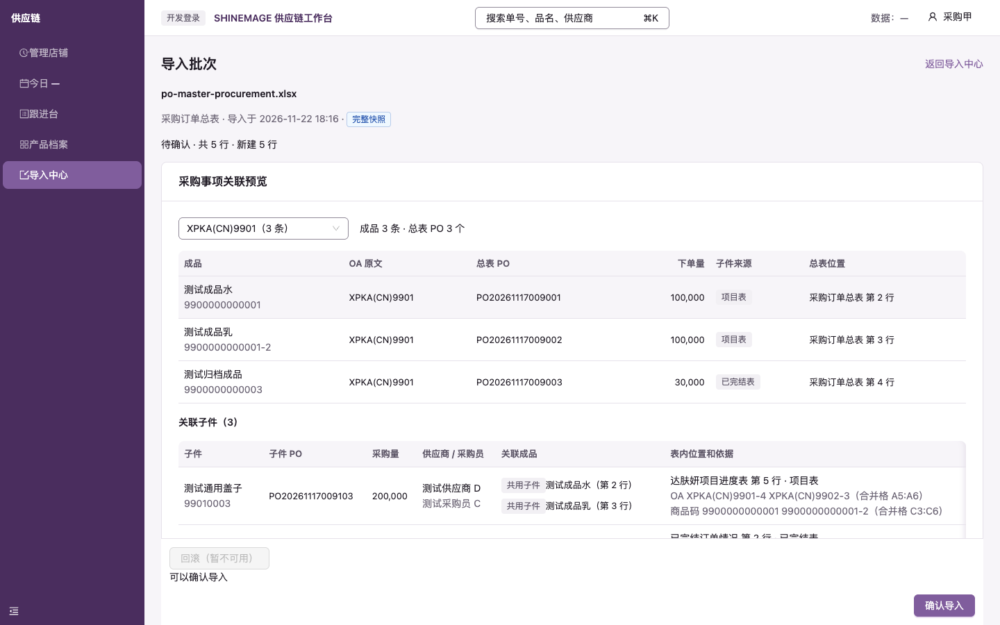

# SHINEMAGE 供应链工作台

SHINEMAGE 是一个自托管的采购跟进工作台。把 Excel 采购表导入工作台，就能按 OA 需求编号、采购单和交付批次查看排期、发货和实收。

## 适合谁用

| 角色 | 日常用法 |
| --- | --- |
| 采购 | 在今日行动板按工厂、紧急程度或批量找出待催订单，复制催单。发货后在到仓备忘录查看待收批次。 |
| 产品经理 | 查看店铺当前进度、总排期和新品开发节点，跟进缺料和交期风险。 |
| 管理层 | 查看卡点、采购负荷和供应商交付趋势，按批次回查明细，用周会和周报核对进展。 |

同一个盖子供多款成品使用时，工作台把关联的成品列在同一笔子件采购事项下。采购可以集中跟进，并回查原表中的工作表和行号。

## 本地试用

### 启动工作台

准备 Git、Docker 和 Docker Compose v2。下面的命令启动本机演示环境，使用独立的 `shinemage-demo` Compose 项目。

```sh
git clone https://github.com/tyuanww/shinemage-supply-workbench.git
cd shinemage-supply-workbench/supply-workbench

docker compose -p shinemage-demo -f docker/compose.yml build app
docker compose -p shinemage-demo -f docker/compose.yml up -d --wait db
docker compose -p shinemage-demo -f docker/compose.yml run --rm --no-deps -T --entrypoint node app --experimental-strip-types scripts/db-lifecycle.ts migrate
docker compose -p shinemage-demo -f docker/compose.yml run --rm --no-deps -T --entrypoint node app --experimental-strip-types scripts/db-lifecycle.ts seed
docker compose -p shinemage-demo -f docker/compose.yml up -d app
```

### 导入一份样本

1. 打开[本机登录页](http://127.0.0.1:8080/login)。**用户**填采购员 `0199f0a0-0000-7000-8000-000000000002`，**访问码**填 `dev-code`。点击 **登录**，进入 **今日**。
2. 打开 **导入中心**，上传[合成采购表](supply-workbench/fixtures/synthetic/po-master-procurement.xlsx)。**导入类型**选择 **采购订单总表**，点击 **开始解析**。
3. 在 **采购事项关联预览** 中查看成品和共用子件，再点 **确认导入**。
4. 在子件采购单 `PO20261117009103` 这一行点击 **打开采购事项**。订单详情会显示共用盖子关联的成品和原表行号，也可以在这里填写跟进记录。



在本机试用时使用合成数据。把真实采购表、数据库备份和访问凭据保存在受控目录。

遇到端口占用，或要检查、停止演示环境时，查看本机运行手册。 [本机运行手册](supply-workbench/RUNBOOK.md)

## 开发与贡献

应用位于 `supply-workbench/`。前端使用 React 和 Ant Design，API 使用 Fastify，数据保存在 PostgreSQL。开发需要 Node.js 24 和 pnpm 11。

- 安装依赖，创建分支或 fork，再提交 PR。 [参与开发](CONTRIBUTING.md)
- 运行与改动相关的检查，查看 PR 实际执行的 CI 作业。 [CI 验证](supply-workbench/docs/ci-verification.md)
- 查找页面规范、项目约定和扩展入口。 [设计规范](supply-workbench/DESIGN.md) · [项目约定](AGENTS.md) · [扩展生成器](supply-workbench/docs/extension-generator.md)
- 报告问题时附上复现步骤和合成样本。 [GitHub Issues](https://github.com/tyuanww/shinemage-supply-workbench/issues)

## 许可证

源码采用 [MIT 许可证](LICENSE)。
