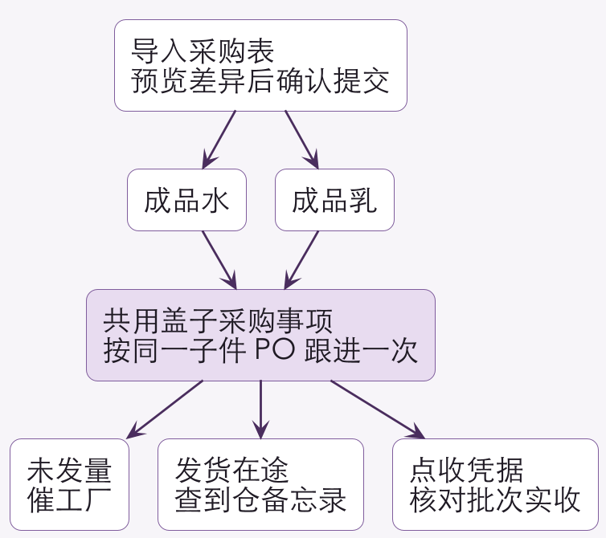
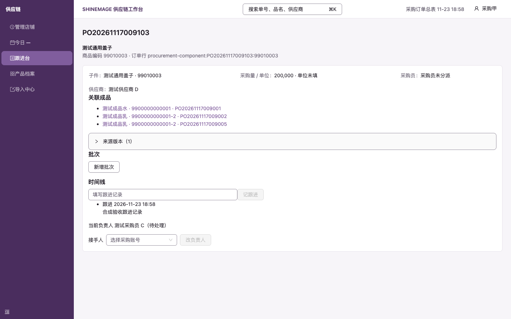
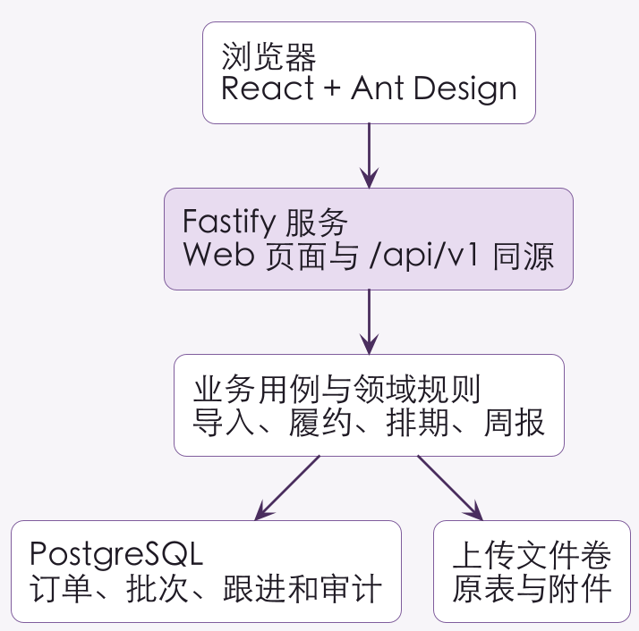

# SHINEMAGE 供应链工作台

导入 Excel 采购表，按 OA 需求、采购单和交付批次跟进排期、催货、发货与实收。

[项目介绍](#项目介绍) · [快速开始](#快速开始) · [版本](#版本) · [功能展示](#功能展示) · [架构设计](#架构设计) · [文档与开发](#文档与开发)

## 项目介绍

SHINEMAGE 是一个自托管的采购跟进工作台。采购每天查还有哪些货要催、哪些货在途。产品经理按店铺查交期和新品节点。管理层从同一份订单与批次记录复核卡点和周报。

多款成品共用一个盖子时，工作台把它们关联到同一笔子件采购事项。采购打开一条记录就能看受影响的成品，并回查原表的工作表和行号。



## 快速开始

### 本地试用

准备 Git、Docker 和 Docker Compose v2。用独立的 `shinemage-demo` 项目启动应用和 PostgreSQL，应用使用本机 `127.0.0.1:8080`。

```sh
git clone https://github.com/tyuanww/shinemage-supply-workbench.git
cd shinemage-supply-workbench/supply-workbench

docker compose -p shinemage-demo -f docker/compose.yml build app
docker compose -p shinemage-demo -f docker/compose.yml up -d --wait db
docker compose -p shinemage-demo -f docker/compose.yml run --rm --no-deps -T --entrypoint node app --experimental-strip-types scripts/db-lifecycle.ts migrate
docker compose -p shinemage-demo -f docker/compose.yml run --rm --no-deps -T --entrypoint node app --experimental-strip-types scripts/db-lifecycle.ts seed
docker compose -p shinemage-demo -f docker/compose.yml up -d app
```

服务就绪后，[健康接口](http://127.0.0.1:8080/api/v1/health)返回 HTTP 200，`ok` 为 `true`，`db` 为 `up`。需要切换端口、看日志或停止服务时，查看[本机运行手册](supply-workbench/RUNBOOK.md)。

### 导入一份样本

1. 打开[本机登录页](http://127.0.0.1:8080/login)。**用户**填演示采购员 `0199f0a0-0000-7000-8000-000000000002`，**访问码**填 `dev-code`。点击 **登录**，进入 **今日**。
2. 打开 **导入中心**，上传[合成采购表](supply-workbench/fixtures/synthetic/po-master-procurement.xlsx?raw=true)。**导入类型**选择 **采购订单总表**，点击 **开始解析**。
3. 在 **采购事项关联预览** 核对成品和共用子件，再点击 **确认导入**。
4. 在子件采购单 `PO20261117009103` 这一行点击 **打开采购事项**。在 **关联成品** 查看三条成品订单行，展开 **来源版本** 回查工作表和行号。填一条跟进记录，刷新后可以在时间线回读。

<details>
<summary>查看导入后的采购事项页面</summary>



</details>

本机试用使用合成数据。把真实采购表、数据库备份和部署凭据保存在受控位置。

## 版本

公开版本 [v0.3.44](https://github.com/tyuanww/shinemage-supply-workbench/tree/v0.3.44) 可下载采购订单总表模板，也可以导出确认日表，填好后按指定要货批次导回。需要复现某个版本时，从对应标签获取源码。[查看所有标签](https://github.com/tyuanww/shinemage-supply-workbench/tags)

## 功能展示

### 导入与回查

提交前在预览里同时看 OA、成品订单和关联子件。确认后可从采购事项回到关联成品，也可查看来源版本与原表位置。


### 按角色工作

| 角色 | 在哪里看 | 可以做什么 |
| --- | --- | --- |
| 采购 | 今日、跟进台 | 按未发量和工厂找待催批次，复制催单。已发在途到备忘录核对，按批次登记发货与实收。 |
| 产品经理 | 管理店铺 | 查看当前进度、总排期与新品开发节点，核对需求日期、承诺与影响产品。 |
| 管理层 | 管理看板（含周报） | 查订单卡点、采购负荷和供应商表现，在周会记录决定并回查完成情况。 |

## 架构设计

浏览器使用 React 和 Ant Design。一个 Fastify 应用服务提供 Web 页面和 `/api/v1`。应用层编排业务用例，领域层负责规则。PostgreSQL 保存结构化记录，上传文件卷保留原表和附件。



| 找什么 | 维护源 |
| --- | --- |
| 页面与导航 | [页面清单](supply-workbench/apps/web/src/app/page-manifest.tsx) |
| 能力与授权 | [能力清单](supply-workbench/packages/contracts/src/capabilities.ts) |
| 导入模板 | [模板注册表](supply-workbench/packages/importers/src/registry.ts) |
| 部署结构与配图 | [Compose 配置](supply-workbench/docker/compose.yml) · [配图源文件](supply-workbench/docs/readme-diagrams.md) |

## 文档与开发

| 我想做什么 | 从哪里开始 |
| --- | --- |
| 启动试用，换端口或查日志 | [本机运行手册](supply-workbench/RUNBOOK.md) |
| 安装依赖，准备第一次提交 | [贡献指南](CONTRIBUTING.md) |
| 找页面和交互规范 | [设计规范](supply-workbench/DESIGN.md) |
| 加页面、能力或导入模板 | [扩展生成器](supply-workbench/docs/extension-generator.md) |
| 选择验证范围或排查 CI | [CI 验证](supply-workbench/docs/ci-verification.md) |

应用代码在 `supply-workbench/`。用 Node.js 24 和 pnpm 11 安装依赖。在该目录运行 `pnpm install --frozen-lockfile`，再按改动范围选择检查。提交前核对[项目约定](AGENTS.md)。报告问题时附上复现步骤和合成样本。[GitHub Issues](https://github.com/tyuanww/shinemage-supply-workbench/issues)

## 许可证

源码采用 [MIT 许可证](LICENSE)。
